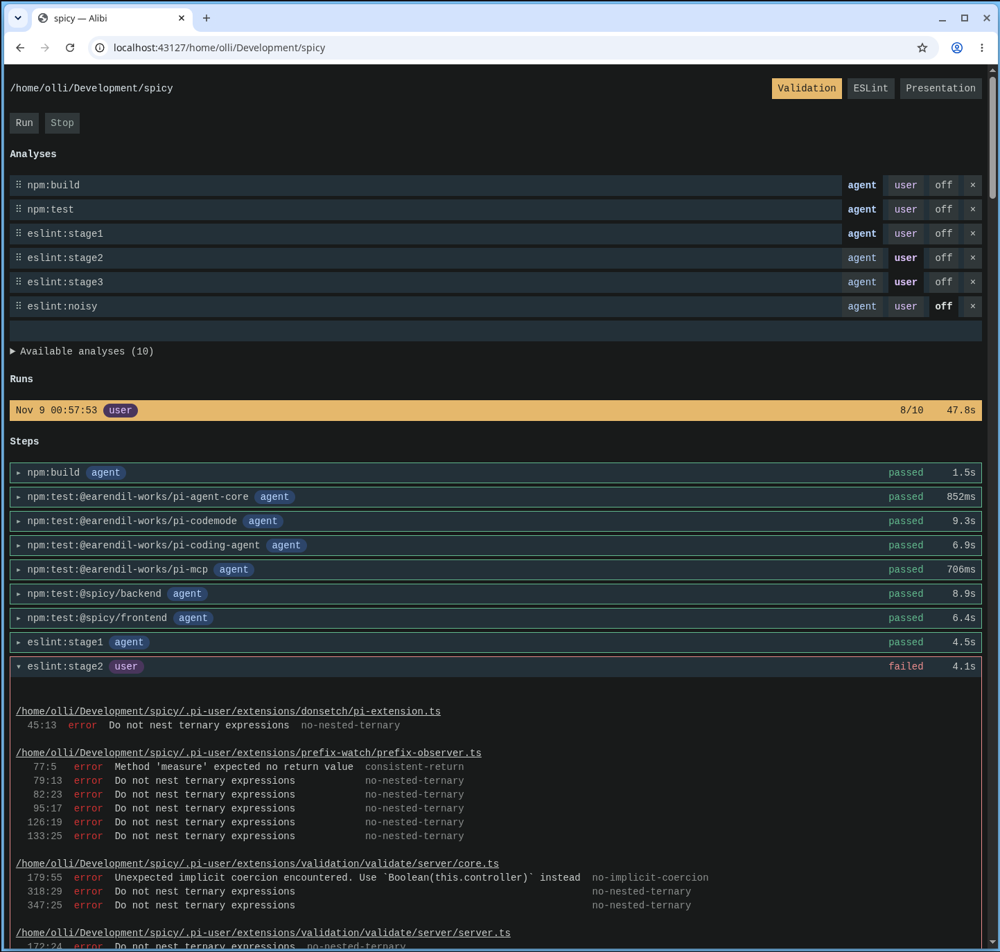

# Alibi

Alibi is a personal quality assurance tool for agentic coding, developed alongside [Spicy](https://github.com/ommann/spicy). It's a solo project made for personal use, exploring how validation can support human supervision without filling the agent's context with unnecessary output.

The inspiration came from `chronic` in [moreutils](https://joeyh.name/code/moreutils/). Running `chronic npm test` stays quiet when the command succeeds and shows its output when it fails. Alibi applies the same idea to validation for coding agents: passing tests and lint produce no output for the development agent. Only failures need its attention, keeping the happy path as cheap as possible in LLM context.

## Three roles

The **development agent** is doing the coding. It gets just one tool, `validate`, with no arguments, so it cannot choose which checks to run or weaken the quality gates through that tool. It runs what the user has decided matters now and receives output only when something needs its attention.

The **user** owns the quality gates, adjusting them through the web UI and deciding which checks are current requirements. Other checks can run alongside them for the user's observation, without reporting their failures to the development agent. This leaves room to explore rules and inspect their results before making them requirements, without burdening the agent with checks it isn't yet expected to satisfy.

The **assistant** helps the user maintain and explore those gates, rather than implement the project under them. Its separate MCP tools can run individual analyses or ESLint rules for investigation, and it can help edit the project configuration in `.alibi.json`. This separates assistance with quality policy from the development agent's job of satisfying it.

## Disclaimer

Alibi is at a very early stage and is intended for local, trusted use. Validation runs project commands; this is not a sandbox or a service to expose to the internet.

## Running

Requires Bun and Linux. The server script uses Bash, `flock`, and `/proc`.

```sh
bun install
bun start
```

Open http://localhost:43127. To stop the server, run `bun stop`.

## Screenshots


